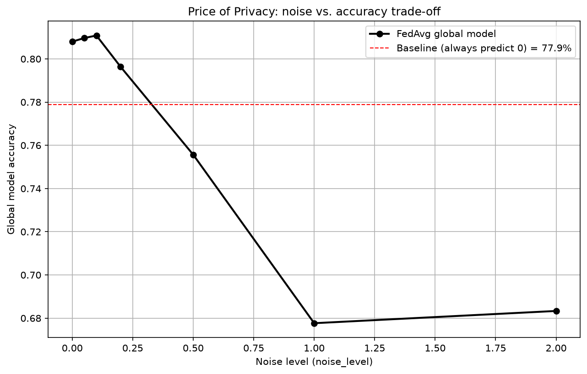

# Federated Learning for Privacy in Multi-Tenant Cloud Data Warehouses

A small simulation of **federated learning** with **noise-based privacy protection**, built for the *Data Warehouses and Data Mining Systems* course at the Silesian University of Technology.

Two bank branches act as independent tenants of a cloud data warehouse. Each branch trains a model on its own data, and only the model weights are shared and averaged, so raw customer data never leaves the branch. The project then measures what this privacy costs in model accuracy.

Inspired by: *Enhancing Privacy-Preserving Data Mining in Cloud-Based Data Warehouses: A Federated Learning Approach for Secure Multi-Tenant Environments* (J. Tyagi, M. Sharma).

## How to run

### 1. Install the tools

You need three programs installed on your computer:

- **Python 3** from [python.org](https://www.python.org/downloads/). On Windows, tick the option "Add Python to PATH" in the installer.
- **Git** from [git-scm.com](https://git-scm.com/downloads).
- **Visual Studio Code** from [code.visualstudio.com](https://code.visualstudio.com/). Optionally, install the "Python" extension from the Extensions tab (the square icon on the left side).

### 2. Download the project

1. Choose a place on your computer where the project should be saved, for example the Desktop.
2. Open a terminal there. On Windows, you can right-click an empty space in the folder and choose **Open in Terminal**, or open PowerShell and move to the folder with `cd Desktop`.
3. Type `git clone https://github.com/chruscielantonina/federated-learning-data-warehouses.git` and press Enter.

Git creates a new folder named `federated-learning-data-warehouses` with all the project files inside.

### 3. Open the project in VS Code

1. Open Visual Studio Code.
2. In the top menu click **File**, then **Open Folder**.
3. Select the `federated-learning-data-warehouses` folder and confirm.

The project files (`data`, `results`, `src`, `README.md` and others) now appear in the Explorer panel on the left.

### 4. Open the terminal in VS Code

In the top menu click **Terminal**, then **New Terminal**. A terminal panel opens at the bottom of the window. The path shown in it should end with `federated-learning-data-warehouses`, which means you are in the project folder and can type commands there.

### 5. Install the dependencies

In the terminal type `pip install -r requirements.txt` and press Enter. This installs numpy, pandas, scikit-learn and matplotlib. Wait until the installation finishes and the cursor appears again.

### 6. Run the simulation

In the same terminal type `python src/federated_learning.py` and press Enter. If Windows says that `python` is not recognized, use `py src/federated_learning.py` instead.

The script prints the accuracy for each noise level in the terminal. When it finishes training, a window with the plot opens. Close that window so the script can end.

### 7. See the results

The plot is also saved as `results/noise_vs_accuracy.png`. Click the file in the Explorer panel to preview it directly in VS Code.

## How it works

Each of the two branches trains its own logistic regression on its own part of the data. Before a branch shares anything, Gaussian noise is added to its model weights, and only these noisy weights (never the customer records) are sent to a central aggregator. The aggregator averages the weights of both branches (FedAvg) into one global model, which is then evaluated on a shared test set.

1. **Data preparation:** the `ID` column is dropped, inconsistent categories in `EDUCATION` and `MARRIAGE` are merged, and 20% of the data is held out as a shared test set.
2. **Tenant split:** the remaining training data is split into two equal parts (Branch A and Branch B).
3. **Local training:** each branch fits its own logistic regression on standardized features and returns only its weights and bias, never its records.
4. **Privacy noise:** Gaussian noise with standard deviation `noise_level` is added to the weights before they leave the branch.
5. **Aggregation:** the aggregator averages the weights of both branches (FedAvg). Since both branches have the same amount of data, this equals weighted averaging.
6. **Evaluation:** the global model is tested for 7 noise levels (0.0 to 2.0) and compared with a trivial baseline that always predicts "no default".

## Dataset

[Default of Credit Card Clients Dataset](https://www.kaggle.com/datasets/uciml/default-of-credit-card-clients-dataset) from Kaggle, originally published in the [UCI Machine Learning Repository](https://archive.ics.uci.edu/dataset/350/default+of+credit+card+clients). It contains 30,000 credit card clients from Taiwan with credit limit, demographics, 6 months of payment history, bill and payment amounts. The target is whether the client defaults in the next month (about 22% of clients do).

The CSV file is included in the repository in `data/UCI_Credit_Card.csv`.

## Results




Baseline (always predict "no default"): **77.9%**.

- Without noise, the federated model reaches about **81%** accuracy without any branch sharing its raw data.
- Small noise (up to about 0.2) barely changes accuracy and the model stays above the baseline.
- From about 0.5 the model drops below the baseline, so stronger noise makes it less useful than a trivial predictor.

These numbers come from a single run with a fixed random seed (`42`). Exact values depend on the noise that is drawn and on library versions.

## Limitations

- The noise is added in the spirit of differential privacy, but it is **not calibrated to a formal (ε, δ) guarantee**, so this is a demonstration of the trade-off, not a proven privacy mechanism.
- Only **one round** of federated averaging is performed.
- The feature scaler is fitted on the whole training pool, which would not be possible in a real federated setting (each tenant would scale on its own data).
- Both tenants get a random, similar split of the data. Real branches could serve very different customers, which would need more advanced aggregation.
- Accuracy is a weak metric for imbalanced data (about 78% / 22%). Precision, recall or AUC would give a fuller picture.
- Results come from a single seed, without repeated runs or confidence intervals.

## Project structure

```
├── data/UCI_Credit_Card.csv       # dataset
├── results/noise_vs_accuracy.png  # generated plot
├── src/federated_learning.py      # simulation code
└── requirements.txt
```

## Tech stack

Python · pandas · NumPy · scikit-learn · matplotlib

## Authors

Antonina Chruściel and Jan Stanek, Computer Science (Databases and Systems Engineering), Silesian University of Technology.